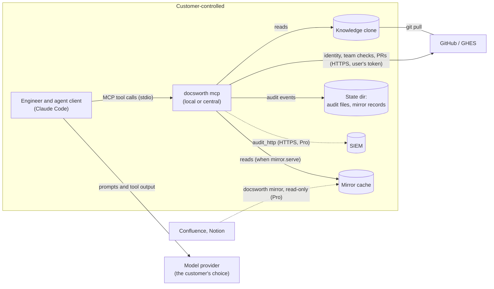

# Docsworth for enterprise security review

This folder is for the person reviewing Docsworth before a pilot. It answers what a
security review asks, says where each answer comes from, and names its limits.

- **This page:** how Docsworth runs, what it inherits from GitHub and the IdP, who is
  responsible for what, and where data goes.
- **[security-questionnaire.md](security-questionnaire.md):** pre-filled answers to the
  usual vendor questionnaire.
- **[data-inventory.md](data-inventory.md):** every store Docsworth writes, its owner,
  its retention and how to delete it.
- **[../security-model.md](../security-model.md):** the mechanisms in detail: identity,
  the one read path, writes, the audit log, prompt injection.
- **[../../SECURITY.md](../../SECURITY.md):** how to report a vulnerability, and how
  releases are built.

## What Docsworth is

A command-line tool and an MCP server that the customer runs. Knowledge pages are
markdown files in the customer's own GitHub repository. Agents (Claude Code, or another
MCP client) search and read them through the server, and propose changes only as pull
requests that the owning team reviews.

**Docsworth runs no hosted service.** There is no Docsworth cloud, account, telemetry or
licence server. Nothing is sent to us.

## Two ways to run it

Every answer in this folder says which mode it holds in.

| | **Local mode** (stdio, today) | **Central mode** (planned) |
| --- | --- | --- |
| How | each user runs `docsworth mcp` on their own machine, from their own clone | one server the customer runs for everyone, from a clone users don't control |
| Identity | the user's own GitHub token | the user's own GitHub token, sent per request |
| Org policy | read from the user's clone, so it steers agents but the user can edit it | enforced by the server |
| Audit log | written on each user's machine; ship it to a SIEM for a record users can't edit | written by the server |
| Writes | enforced by GitHub in both modes: push access, branch protection, code-owner review | the same |
| Status | shipped | built when a design partner needs it |

**What holds in both modes.** GitHub decides who can read the repository and who can
merge. The server never writes to a default branch, never serves a page across its ACL,
and, with `github.repo` set, fails closed when it can't establish who is calling. (With
no `github.repo`, local-only mode serves `internal` pages to whoever runs it, and
refuses writes.)

## The enterprise checklist

The common requirements, from the research in
[../sdlc/v0.2/research.md](../sdlc/v0.2/research.md). **Inherited** means the customer
gets it from GitHub or their IdP once they configure it; the prerequisite is listed.

| Requirement | Status | How, and the prerequisite |
| --- | --- | --- |
| SSO (SAML/OIDC) | Inherited | Identity is the caller's GitHub token. With SAML SSO enforced on the org, a token not authorized for it fails closed, with GitHub's authorization link. |
| MFA | Inherited | Enforced by the GitHub org or the IdP. |
| Deprovisioning | Inherited, with a window | Removal from the org (SCIM or EMU) stops writes at once and reads within `policy.identity_cache_seconds` (default 300). Removal from a team needs IdP group to team sync; the team's pages hide within the same window. |
| Roles and permissions | Built | Reader, contributor, owner and admin, derived from GitHub and `policy:`. Per-tool team allowlists, a write switch, owner-only verify. Enforced against the user only in central mode. |
| Audit log, exportable | Built | One event per tool call, named for a person, with intent recorded before every write. Files with retention; `audit_http` ships each event to a SIEM (Pro). |
| Agent access on behalf of a user | Built | The agent acts with the user's own token, so it can't reach more than the user can. Installation tokens, which act for no one, are refused. |
| Admin reporting | Built (Pro) | `docsworth access-review` (who can see, verify and approve what, with branch-protection checks) and `docsworth usage-report`. |
| Change management | Inherited | Every change is a PR. CODEOWNERS routes it to the owning team, and binds only when branch protection requires code-owner review; `docsworth access-review` checks that. |
| Encryption in transit | Built | Docsworth refuses to send a credential over plain HTTP: a GHES `api_url`, a Confluence URL, the SIEM collector and Slack webhooks must be `https://` (plain HTTP only on loopback). GitHub, Notion and Anthropic are fixed HTTPS endpoints. The SIEM sink also refuses redirects. |
| Encryption at rest | Customer's | Docsworth encrypts nothing itself. GitHub encrypts the repository; machines need disk encryption for clones, the mirror cache and audit files. |
| Retention and deletion | Built | [data-inventory.md](data-inventory.md), with `retention_days`, `docsworth mirror-purge` and a git-history erasure procedure. |
| Data residency | Customer's | Data stays in the customer's GitHub, machines and connected systems. |
| Deployment in the customer's network | Partly | Local mode runs anywhere the user does, including GitHub Enterprise Server (`github.api_url`; not yet tested against a live instance). Central mode is planned. |
| Resilience to GitHub outages and limits | Built | Reads retry what passes (no answer within 30 s, a 5xx, a rate limit GitHub says lifts within 10 s) up to three times; writes never retry, since a second try could open a second PR. A rate limit is named as one, with when it lifts, not as "no access". When GitHub can't confirm access, the call fails closed. |
| Vulnerability disclosure | Built | [SECURITY.md](../../SECURITY.md). |
| Signed releases, provenance | Planned | CI produces an SBOM today. Signing and provenance come with the first published release. |
| Contracts: SLA, support, breach notice, DPA | Not in this repo | Commercial terms. |

**Not offered:** a hosted service (and so SOC 2), region choice, BYOK, HIPAA, FedRAMP,
legal hold, DLP, IP allowlists (for central mode, that's the customer's ingress),
multiple IdPs, a web editor, and writing back to Confluence, Notion or Google.

## Who is responsible for what

| Area | Docsworth | GitHub | The customer |
| --- | --- | --- | --- |
| Who can read the knowledge repo | applies it to every tool call | enforces it on every clone and API call | grants repo access |
| Team ACLs on pages | serves each page only to its audience | provides team membership | keeps teams current (IdP sync) |
| Writes to the default branch | never makes one | enforces branch protection and code-owner review | turns them on |
| Sign-in, MFA, SSO | uses whatever token GitHub accepts | enforces SSO on tokens | configures the IdP and the org |
| Audit | writes events, fails closed when required | keeps its own audit log of repo activity | runs the SIEM, keeps the copy |
| Mirrored Confluence and Notion content | reads with the configured account, skips restricted pages, never writes back | | chooses the service account and its access |
| Model provider | makes no model calls (except the opt-in benchmark) | | chooses the agent client and its provider, which receive tool output |
| Machines | | | disk encryption, backups, who may run the server |

## Where data goes

- **Docsworth's own outbound calls:** GitHub (or GHES), and, only when configured,
  Confluence, Notion, the SIEM collector, Slack webhooks for the digest, and the
  Anthropic API for the benchmark.
- **What reaches a model provider:** whatever the agent client sends. That includes the
  tool output the server returns: page text the caller is allowed to see. Choose the
  client and provider with that in mind; Docsworth has no channel to them.
